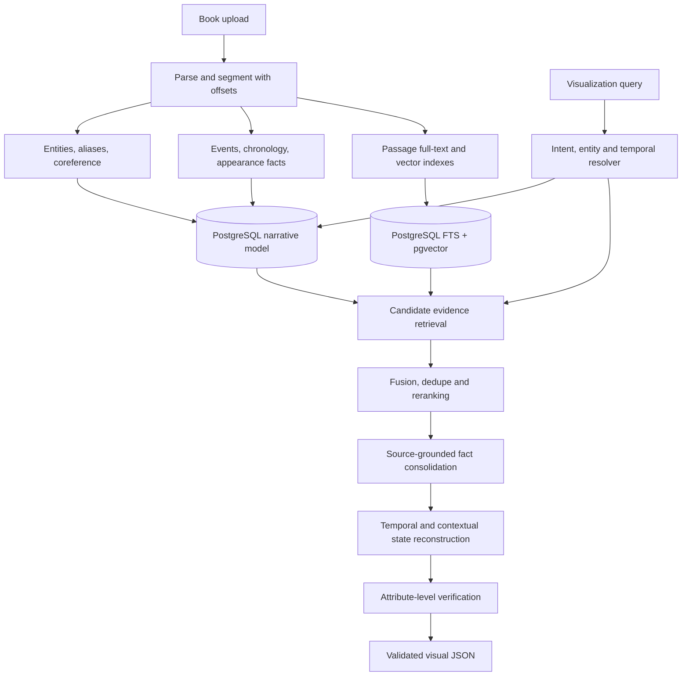

# vision — retrieval and narrative grounding strategy

**Decision:** adopt **entity-aware hybrid lexical + semantic retrieval**, anchored to a **source-linked temporal narrative knowledge model**, with candidate fusion, reranking, temporal reconstruction, and attribute-level verification.  
**Status:** chosen baseline architecture; not an A/B comparison proposal.

## 1. Why this approach

Vision must recover **all relevant visual evidence** for a subject whose description can be scattered across hundreds of pages, expressed indirectly, and changed by events. A character might be a child in a flashback, an armored knight in battle, and a casually dressed parent at home. Relevant details can appear in unrelated chapters, and later text can refer to earlier story time.

No single generic similarity search, hierarchical table of contents, or precomputed summary solves this. The system needs:

1. **Lexical recall** for names, aliases, distinctive objects and exact text.
2. **Semantic recall** for indirect paraphrases and descriptions without exact names.
3. **Entity-linked facts** so evidence across passages attaches to the correct subject.
4. **Temporal/event grounding** so conflicting appearances are placed in the correct story interval.
5. **Verification** so an attractive output cannot mask incorrect or unsupported attributes.

These are complementary mechanisms within **one adopted pipeline**, not alternative products or retrieval modes to compare.

## 2. Architectural overview



**Source of truth:** the original document and exact parsed spans. The narrative model is a revisable derived index, never an unquestioned authority.

## 3. Ingestion and indexing

### 3.1 Document normalization

Use Docling/format adapters to produce a consistent representation:

```text
work → chapters/sections → scenes (when detectable) → passages → offsets
```

For each passage, retain: document ID, chapter/section, page when available, text offsets or anchors, normalized text, parser version, and surrounding context pointers. Scene boundaries are useful but may be uncertain; retain passages even when scene classification fails.

Chunk by **narrative and paragraph boundaries**, not arbitrary fixed character counts. Allow overlapping context around dialogue/scene transitions. Keep both fine-grained evidence spans and slightly wider retrieval windows; otherwise short visual details can be disconnected from the entity they describe.

### 3.2 Entity and alias resolution

Extract character, location, object and organization mentions. Build canonical entity IDs and aliases, including titles, nicknames, pronouns and role references, but avoid blindly merging ambiguous mentions (e.g., “the captain” might name different people).

Record `entity_mentions` pointing to exact passage spans. Link a mention only when evidence supports the mapping; retain unresolved candidates and ambiguity scores. Alias-based expansion improves lexical retrieval without pretending that every textual match refers to the same subject.

### 3.3 Events and temporal ordering

Extract events that affect appearance or scene context: birth/childhood, travel, injury, aging, promotion, war, disguise, house damage, restoration, etc.

Represent:

- **Source order:** where the passage occurs in the book.
- **Story time:** explicit dates/ages, event IDs or relative expressions.
- **Relations:** before, after, during, overlaps, unknown, and potentially inconsistent.
- **Perspective/modality:** narrated fact, memory, speculation, dream, rumor, figurative language.

Do **not** force a complete ordered timeline from an ambiguous narrative. A flashback is indexed by its story time while keeping its later source position.

### 3.4 Visual fact extraction

Extract atomic attributes and their evidence, e.g.:

```json
{
  "entity_id": "arthur",
  "attribute": "facial_scar",
  "value": "scar on left cheek",
  "scope": "persistent_from_event",
  "valid_from_event": "battle_of_north_pass",
  "valid_to_event": null,
  "context": null,
  "support_type": "explicit",
  "source": {"passage_id": "p-241", "span_start": 112, "span_end": 138},
  "perspective": "narrator",
  "status": "supported"
}
```

A fact can be stable, temporary, valid for an interval, scene-specific, contradictory, or unresolved. Missing `valid_to_event` means **no end is established**, not automatic proof that it lasts forever. Appearance profiles are *computed from facts*; they are not manually flattened into one canonical description.

### 3.5 Search indexes

Use one PostgreSQL database:

- **FTS (`tsvector` + GIN):** passages and entity aliases; exact terms, phrases and proximity-sensitive patterns.
- **pgvector:** embeddings of passage windows/scene summaries, with model/version metadata and appropriate ANN indexing as collection size warrants.
- **B-tree/GIN relations:** `entity_id`, `passage_id`, event associations, temporal anchors, and source boundaries.

Language-specific lexical normalization needs attention: stemming appropriate to the book language and preservation of names/proper nouns. Do not rely on one English-only tokenizer for every language.

## 4. Query understanding

A user query is converted into a structured plan:

```json
{
  "subject": {"type": "character", "id": "arthur"},
  "intent": "visualize",
  "time": {"event": "return_home", "relative_to": "great_war"},
  "context": {"place": "home", "situation": "with_family"},
  "source_cutoff": {"mode": "whole_book"},
  "style": "cinematic_realism",
  "ambiguity": []
}
```

Determine subject identity, requested moment, scene context, artistic preferences, and spoiler boundary. Distinguish **“chapter 14”** as a source constraint from **“when he was ten”** as a story-time constraint. When the query is underspecified and profiles materially differ, present contextual options; when a single interpretation is well-supported, proceed with it while stating the chosen context.

## 5. The adopted evidence retrieval pipeline

### Step 1 — Entity and temporal lookup

Resolve the subject to one or more candidate entity IDs and determine relevant event(s) or intervals. Pull already extracted visual facts and linked mentions, subject to source cutoff. Include facts about places and relevant participants when necessary to reconstruct a scene.

**Do not immediately discard facts from earlier moments.** Earlier persistent changes can affect later appearances; they must be evaluated for temporal validity.

### Step 2 — Lexical retrieval

Search FTS using canonical names, safe aliases, key event terms, environmental terms, distinctive objects, and query expressions. Include entity mention-linked passages to find descriptions that do not repeat the name in the same paragraph.

### Step 3 — Semantic retrieval

Search passage/window embeddings with query expansions aimed at appearance, setting, clothing, architecture, and situation. Restrict to the uploaded work and the permitted reading boundary. Use entity/event filters when confident, but avoid hard filters that eliminate ambiguous yet relevant evidence.

### Step 4 — Candidate union, deduplication and fusion

Union results from entity-linked fact spans, lexical search, and semantic search; deduplicate by canonical passage/span. Normalize method-specific ranks and use **reciprocal rank fusion (RRF)** for candidate ordering. Preserve provenance about which retrieval path found each span.

Entity-linked and known canonical facts must be carried as a **protected evidence set**, not dropped merely because their vector similarity is low. Fusion ranks candidate passages; it does not decide which visual facts are true.

### Step 5 — Context-aware reranking

Rerank candidate passages for: correct entity, visual relevance, correct story moment, context match, and directness of evidence. Expand top passages to include the paragraph or neighboring passage needed to resolve pronouns and negation. Preserve a diverse set across appearance, clothes, environment, event-related changes, and world atmosphere rather than filling the context window with near-duplicates.

### Step 6 — Grounded consolidation

Recheck retrieved text against the original spans. Extract/merge atomic facts, keeping:

- Attribute, value and entity ownership.
- Textual evidence and source location.
- Explicit vs inferred vs creative status.
- Story-time interval and situational conditions.
- Perspective/modality, contradictions and unknowns.

A statement such as “he removed his armor at the doorway” must not become “he is wearing armor inside the house.” A rumor or dream must not silently become canon.

### Step 7 — Temporal state reconstruction

Construct the appearance **at the requested moment**:

1. Start with supported identity traits applicable at that point.
2. Apply changes known to occur **before or by** the requested event.
3. Exclude future changes and traits belonging to earlier superseded states.
4. Overlay scene-specific clothes, objects, posture and environmental details.
5. Resolve or surface contradictions; do not fabricate chronology.
6. Mark unknown attributes and necessary creative completions distinctly.

For `Arthur at home after the war`: preserve a scar acquired in the war *if* the narrative establishes it persists or there is no contradictory later evidence; use civilian clothes only if the home scene supports them; never keep battle armor by default. A child portrait excludes any later-acquired scar.

### Step 8 — Attribute-level verification

Before composing JSON, verify each claimed fact against the cited span and temporal context:

- Is the entity correct?
- Does the passage actually entail the attribute and its value?
- Is the fact applicable to the requested time and situation?
- Is it narration, dialogue, rumor, hypothetical, dream, or metaphor?
- Is the attribute contradicted by better contextual evidence?

Unsupported facts are removed from canonical fields or downgraded to clearly labeled creative assumptions. Verification can combine deterministic checks (IDs, cutoffs, schema, time constraints) with source-bound model adjudication; do not accept a generic “looks grounded” verdict.

### Step 9 — Structured generation

Generate a **provider-independent visual specification**, then produce image-provider-specific prompts as an adapter layer. JSON contains:

- Subject and resolved story context.
- Canonical appearance state and environment.
- Evidence source references per attribute.
- Conflicts/uncertainty and unknowns.
- Explicit creative additions and style choices.
- Final positive/negative prompt where supported by provider.
- Source cutoff and processing/schema versions.

Validate with Pydantic/JSON Schema, then enforce invariants: every canonical fact has valid in-scope evidence, no future-only fact leaks into earlier states, and creative additions are not presented as quotations.

## 6. Retrieval/data interfaces

Suggested internal types:

```python
class RetrievalRequest:
    work_id: str
    entity_id: str | None
    query: str
    story_event_id: str | None
    source_chapter_cutoff: int | None
    scene_context: dict

class EvidenceCandidate:
    passage_id: str
    span_start: int
    span_end: int
    retrieval_sources: list[str]  # entity, lexical, vector
    relevance_score: float | None
    entity_ids: list[str]
    event_ids: list[str]

class GroundedVisualFact:
    entity_id: str
    attribute: str
    value: str
    scope: str
    temporal_constraints: dict
    context_constraints: dict
    evidence_ids: list[str]
    support_type: str
    status: str
```

These are conceptual contracts, not final ORM or Pydantic definitions. Use IDs and typed schemas in actual code.

## 7. Efficiency and quality safeguards

- **Index once, query many times:** do substantial extraction/linking during ingestion, then perform targeted reconstruction per query.
- **Incremental and versioned:** re-extract affected chapters, invalidate dependent facts and caches when sources or models change.
- **Cache scoped outputs:** keyed by work/index version, entity, time, context, creative mode, and spoiler boundary.
- **Budgeted retrieval:** cap candidate counts and model context; keep protected canonical facts regardless of generic ranking thresholds.
- **Progressive enrichment:** extract high-value entities/events from ingestion, while permitting query-triggered deeper extraction of overlooked passages. This is coverage improvement, not a second competing retrieval system.
- **Bounded prompt context:** compress redundant evidence without losing exact source spans or exceptions/negations.
- **Fail explicitly:** unknown identity, unclear timeline, ambiguous pronouns, and conflicting descriptions should produce warnings or context options.
- **Security:** filter all queries and caches by work permissions; never treat uploaded text as executable instructions.

## 8. Failure cases and expected behavior

| Case | Required behavior |
|---|---|
| Character referenced by title and nickname | Resolve aliases to canonical identity; preserve ambiguous mentions |
| Character first described in a later flashback | Use story chronology, not chapter order |
| Childhood query; scar acquired as adult | Exclude future scar |
| Battle vs home in same period | Apply scene-specific attire and props |
| Damaged house later rebuilt | Reconstruct requested version with event validity |
| Narrator speculates about eye color | Mark uncertain, not explicit canon |
| Another character wears similar armor | Check entity ownership before inclusion |
| Later chapter beyond reading cutoff describes an earlier event | Do not leak that passage or derived facts |
| Author omits a visual trait | Leave unknown or label creative interpolation |
| Document parse loses chapter structure | Surface degraded evidence quality; use preserved spans when available |

## 9. Implementation breakdown

Within `apps/api/app/services/`:

```text
retrieval/
├── query_plan.py       # normalized retrieval scope
├── entity_lookup.py    # canonical subject and aliases
├── lexical.py          # PostgreSQL FTS
├── semantic.py         # pgvector retrieval
├── fusion.py           # candidate union + RRF
├── rerank.py           # context-sensitive passage ordering
└── evidence.py         # source-span loading and dedupe

narrative/
├── segment.py          # passages and scene markers
├── entities.py         # mention resolution
├── events.py           # temporal event extraction
├── chronology.py       # partial event ordering
└── visual_facts.py     # extracted atomic claims

reconstruction/
├── state.py            # appearance at requested moment
├── context.py          # clothing, environment, scene
└── conflicts.py        # disagreement and uncertainty

verification/
├── claims.py           # entailment and source checks
├── temporal.py         # cutoff and interval guards
└── provenance.py       # exact cited spans

visualization/
├── specification.py    # provider-independent JSON
├── prompts.py          # downstream prompt adapter
└── schemas.py          # typed output contracts
```

Keep orchestration deterministic enough to trace why each output attribute was included. Provider interfaces should make models replaceable without changing source storage or temporal logic.

## 10. Acceptance criteria

This is the chosen implementation architecture, **not a proposal to compare multiple retrieval stacks**. Still, features require correctness checks before release:

- Given a character with descriptions in separate chapters, the result can cite all material attributes from their actual passages.
- A childhood visualization never includes an injury acquired later in story chronology.
- Two simultaneous contexts (battle armor vs home attire) can produce different scene-specific states without altering identity.
- Flashbacks do not corrupt ordering; source boundaries prevent spoiler leaks.
- A generated canonical fact without an actual source span is rejected or marked creative.
- Contradictory or uncertain descriptions are visible rather than silently flattened.
- Output obeys the JSON schema and retains traceability down to each attribute.

## 11. Final architectural position

**Chosen retrieval:** PostgreSQL full-text + pgvector semantic search + entity-linked evidence; deduplication/RRF; context-aware reranking; temporal world-state reconstruction; attribute-level verification.  
**Chosen knowledge representation:** PostgreSQL-backed narrative entities, mentions, events, partially ordered story time, and source-linked visual facts.  
**Not selected:** PageIndex, standalone graph/vector infrastructure, and generic top-k-only RAG.

The purpose is not to maximize the number of retrieval techniques. It is to recover the right evidence, understand **when** it is true, and construct an appearance faithful to the requested world and moment.
