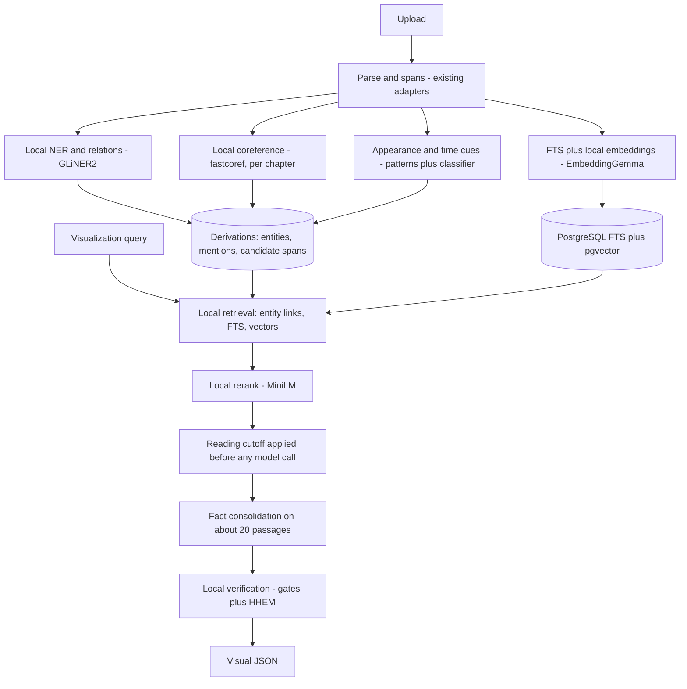

# Research: local-first processing and minimal-disclosure retrieval

**Status:** Proposed — research for maintainer review, 2026-10-20, with
evaluation spike results in section 10. Only the query-time fallback (Groq with
Zero Data Retention, DEC-36) is decided; nothing else here is adopted; the [retrieval strategy](../architecture/retrieval-strategy.md) and
the [decision register](../product/decision-register.md) remain authoritative
until a maintainer accepts an ADR. Figures marked *estimate* are unmeasured.

## 1. Why this review

The adopted pipeline extracts entities, events and visual facts with an LLM at
ingestion. Implemented as T18–T22, that means the **whole book** is sent to a
model provider three times (once per stage, plus retries). Provider data
handling was not part of the original architecture, and the live runs on the
synthetic corpus exposed three problems:

| Problem | Observation |
|---|---|
| Disclosure | The FreeLLM gateway routes each call to a different upstream (Google, Groq, NVIDIA, OpenRouter-hosted models). Free tiers may log, review or train on prompts. |
| Reliability | `auto` routing returned a different model per call; a pinned model was unavailable upstream (Google 503); weak routes returned invalid JSON. |
| Capacity | Groq's free plan allows about 200K tokens/day for `gpt-oss-120b`; one novel needs on the order of 1M+ tokens across three stages (*estimate*). |

Goal: a processing and retrieval strategy that keeps book text on the machine
by default, is reproducible, and sends at most small, cutoff-filtered excerpts
to an external model — or nothing at all.

## 2. Constraints of the target machine

Measured on 2026-10-20:

| Resource | Value | Consequence |
|---|---|---|
| CPU | Intel i5-1155G7, 4 cores / 8 threads | Encoder models are practical; large generators are not |
| RAM | 11 GB total, about 4 GB free in normal use | Prefer models under about 1 GB each, loaded one at a time |
| GPU | Intel Iris Xe (integrated) | No CUDA; CPU inference only |
| Disk | 1.2 GB free (root at 100%) | **Blocker:** about 3 GB must be freed before any local model work |
| Runtimes | Ollama installed | GGUF generators and embedding models can run locally |

## 3. Provider options (if anything leaves the machine)

| Provider | Data handling | Structured output | Cost / limits |
|---|---|---|---|
| Google Gemini, paid tier | Content **not** used to improve products | JSON schema via OpenAI-compatible endpoint | 3.8 Flash $0.75 / $3.75 per 1M in/out until 2026-12-31, then $1.50 / $7.50 |
| Google Gemini, free tier | Content **used** to improve products; human review possible | Same | Free, rate-limited |
| Groq | No retention by default; Zero Data Retention available to all customers in Data Controls; abuse logs up to 30 days unless ZDR | Strict JSON schema (constrained decoding) on supported models, including gpt-oss | Free plan about 30 RPM, 8K TPM, 200K TPD for gpt-oss-120b |
| NVIDIA build (trial) | Trial terms; prototyping only | OK | Free trial |
| OpenRouter `:free` | Per-endpoint; roughly half of free endpoints may train (third-party snapshot) | Varies | Free |

Groq with ZDR is the strongest free option for privacy, but its daily token
budget only fits **query-time** use with small excerpts, not whole-book
extraction. Paid Gemini is the strongest quality option if spending is acceptable.

## 4. Local building blocks found

| Need | Candidate | Licence / activity | Notes |
|---|---|---|---|
| Entities, relations, classification | **GLiNER2** (205M, schema-driven, one CPU pass) | Apache-2.0; active (pushed 2026-10-18) | Designed for GPU-scarce, on-prem privacy; vendor claims about 1–2 F1 below dedicated NER |
| Zero-shot NER (fallback) | GLiNER | Apache-2.0; active | Older single-task model family |
| Coreference | **fastcoref** (F-coref / LingMess) | MIT; active (pushed 2026-05) | Process per chapter to bound memory |
| Coreference (alternative) | Maverick | Licence unclear; pushed 2025-06 | LitBank about 78 F1; CPU supported |
| Book pipeline | BookNLP | MIT; last push 2024-07 | NER, coref, quote attribution; README warns book-length coref over-merges |
| Appearance passages | Hand-written lexical-syntactic patterns plus a small classifier | — | Research on fiction found hand-written queries beat an ML classifier for physical descriptions |
| Embeddings | **EmbeddingGemma-300M** | Gemma terms | Top open multilingual model under 500M on MTEB; under 200 MB RAM quantized; 768-d, truncatable |
| Reranking | ms-marco MiniLM cross-encoder (22M) | Apache-2.0 | Fast on CPU; bge-reranker-v2-m3 (568M) is better quality but slow on CPU |
| Grounding check | **HHEM-2.1-open** (FLAN-T5 base) | Apache-2.0 | Premise/hypothesis score; under 600 MB; about 1.5 s per 2K tokens on CPU (secondary source); English only |
| Local generator | Qwen3-4B or Gemma 4B class via Ollama with `format` schema | Open weights | About 7–10 tokens/s on comparable laptops (*estimate*); suitable only for short outputs |

## 5. Proposed architecture

**Ingestion is local and deterministic.** Entities, mentions, coreference,
candidate appearance spans, temporal and modality cues, and both search indexes
are produced without network access. Outputs keep the existing derivation,
grounding and provenance contracts.

**LLM use moves to query time and shrinks.** After local retrieval, reranking
and the reading cutoff, only the selected evidence (target: about 20 passages,
about 5K tokens per question) is consolidated into atomic facts with the strict
schema. Order of preference:

1. Local generator through Ollama, if it meets the evaluation bar.
2. Groq `gpt-oss-120b` with Zero Data Retention (about 30–40 questions/day on
   the free plan, *estimate*).
3. Paid Gemini, if the maintainer accepts per-use cost.

**Verification stays local:** the existing lexical gates plus an HHEM grounding
score for each fact against its cited span; low scores downgrade the fact to
non-canonical instead of silently accepting it.

### What carries over unchanged

Derivations and attempt-guarded publication, quote grounding, dependency-closure
eligibility and browse, the provider envelope and run lineage, the evaluation
harness against the annotated corpus, and the worker pipeline. T18–T20 become
local adapters behind the same derivation stages; Phase 4 adds query-time
consolidation through the provider envelope.

## 6. Quantization

Quantization reduces disk, RAM and CPU time, which matters more than peak
quality on this machine. It must be measured, not assumed lossless.

| Model type | Method | Expected effect (*estimate*) |
|---|---|---|
| Encoders (GLiNER2, fastcoref, EmbeddingGemma, MiniLM, HHEM) | ONNX Runtime dynamic int8 (`onnxruntime.quantization.quantize_dynamic`) or Optimum export | About 2–4x smaller and faster on CPU; small accuracy loss typical |
| Embeddings | Matryoshka truncation 768 → 256 dimensions, optionally int8 vectors in pgvector | 3x smaller index; recall must be checked |
| Generator | GGUF Q4_K_M (Ollama default) or Q5_K_M | 4B model around 2.5–3 GB on disk and in RAM |

Rules: record quantization method, file hash and runtime version in the
processing version so results stay reproducible, and compare each quantized
model against its full-precision version on the annotated corpus before use.

## 7. Risks and open questions

| Risk | Mitigation |
|---|---|
| Local event and fact extraction weaker than a large LLM | Extract only candidates locally; consolidate facts at query time over a small, relevant set |
| Book-length coreference over-merges | Per-chapter coref; keep ambiguous candidates (existing behaviour); measure false merges |
| English only (HHEM, patterns) | Matches DEC-22; other languages stay open |
| CPU time per book unknown | Measure in the spike; encoder passes expected in minutes (*estimate*) |
| Disk full | Free about 3 GB before the spike |
| Model licences (Gemma terms, Maverick unclear) | Review before adoption |

## 8. Proposed evaluation spike

Before any architecture change:

1. Install GLiNER2, fastcoref and EmbeddingGemma (full precision and int8).
2. Run them on the synthetic corpus and one public-domain novel.
3. Score with the existing harness: misses, false merges, splits, ambiguity
   violations; plus retrieval recall of annotated spans.
4. Measure wall time and peak RAM per book.
5. Try one local generator for query-time consolidation on the fixture cases.

If the results hold, record the change as ADR-0003 (proposed) for acceptance.

## 9. Decisions requested

1. Free about 3 GB of disk for local models.
2. Approve the evaluation spike.
3. Choose the query-time fallback: Groq with ZDR (free), paid Gemini, or
   local-only.
4. Accept or reject quantized models as the default once measured.

## 10. Spike results (2026-10-20)

Measured on the target laptop with `scripts/spike/local_pipeline.py` in an
isolated environment (`.local/spike`, transformers 4.57, sentence-transformers
5.1, torch 2.14 CPU). Corpora: the annotated synthetic story (14 passages) and
*The Strange Case of Dr Jekyll and Mr Hyde* (Project Gutenberg #43; 334
passages, 137K characters, about 25K words). No book text left the machine;
EmbeddingGemma and Qwen3 ran in the local Ollama server.

### Entities and coreference

| Run | Result |
|---|---|
| Synthetic, GLiNER2 base fp32 + fastcoref | 0 misses, 0 false merges, 0 splits against the annotations; "the captain" never resolved to one person; NER 1.8 s, coref 0.8 s, 24 pronouns linked |
| Jekyll, same pipeline | NER 198 s, coref 24.5 s, 3 min 51 s wall; 1,543 mentions; 771 pronoun links; peak RSS 4.4 GB |

On Jekyll all main characters were found (Utterson, Jekyll, Hyde, Poole,
Lanyon, Enfield). Remaining issues are rule-level: full names not unified with
surnames ("Henry Jekyll" / "Jekyll"), "you" and "will" tagged as characters,
role nouns ("the lawyer") needing coreference. Peak memory comes from
coreference on long chapters; windowed coreference is needed on this machine.
Extrapolated cost: about 15 minutes for a 100K-word novel (*estimate*).

### Appearance passages

| Method (synthetic, 42 sentences, 24 gold) | Precision | Recall |
|---|---|---|
| GLiNER2 classification | 0.89 | 0.33 |
| Hand-written patterns | 0.76 | 0.79 |

Patterns win on recall and cost nothing; the classifier took 129 s for 1,361
Jekyll sentences and also fired on non-visual uses ("name your figure"). This
matches the cited research on fiction.

### Retrieval

| Method | Synthetic recall@5 (14 cases) | Jekyll recall@5 (4 queries) | Jekyll indexing |
|---|---|---|---|
| BM25 | 1.00 | 0.25 | instant |
| bge-small fp32 | 1.00 | 0.55 | 9 s |
| bge-small int8 | 1.00 | 0.30 | 7 s |
| EmbeddingGemma (Ollama) | 1.00 | **0.85** | **1,518 s** |
| EmbeddingGemma (sentence-transformers, fp32) | — | **0.85** | **107 s** |
| RRF fusion | 1.00 | 0.80 | — |
| RRF + MiniLM rerank | 0.96 | — | — |

The synthetic story is too small to separate methods. On the novel,
EmbeddingGemma is clearly best. Through Ollama, indexing took about 4.5 s per
passage; loading the official `google/embeddinggemma-300m` weights directly in
sentence-transformers (2026-10-21) gave the same recall in 107 s (about 0.3 s
per passage, 14x faster) with 2.4 GB peak memory. Jekyll gold passages were identified by distinctive phrases, so the
sample is small (4 queries).

### Grounding check (HHEM-2.1-open, 18 claims)

| Variant | Accuracy | Time | Notes |
|---|---|---|---|
| fp32 | 0.72 | 1.9 s | Accepted the dream (0.95), the denied armor (0.81) and the rumor (0.73) |
| int8 | 0.83 | 0.46 s | Rejected all 9 unsupported claims but also 3 supported ones |

HHEM does not judge modality or negation; Vision's deterministic gates cover
exactly those cases, so HHEM is useful only as a secondary signal.

### Local generator (Qwen3 4B Q4 via Ollama)

About 1 token/s under the available RAM; one of three questions returned invalid
JSON after 19 minutes, and the other two produced one fact each. Not viable on
this machine.

### Quantization findings

- PyTorch dynamic int8 (deprecated API in torch 2.14) **broke GLiNER2**: zero
  entities, even with attention layers left in fp32.
- It **halved bge-small recall** on the novel (0.55 → 0.30).
- It made HHEM 4x faster with shifted calibration (see above).
- Conclusion: no default quantization; any quantized model must pass the same
  evaluation. ONNX-based quantization remains untested.

### Revised recommendation

1. **Ingestion, local:** GLiNER2 base fp32 for entities, fastcoref with windowed
   chapters for pronouns, hand-written patterns for appearance passages, rule
   fixes for surname unification and pronoun filtering.
2. **Embeddings:** EmbeddingGemma loaded directly through sentence-transformers
   (Gemma licence accepted on Hugging Face). A typical novel indexes in an
   estimated 8–10 minutes on this laptop. bge-small is the fast fallback.
3. **Query-time consolidation:** Groq `gpt-oss-120b` with Zero Data Retention
   and strict JSON schema (DEC-36), over cutoff-filtered excerpts only. A local
   generator is not viable on this hardware.
4. **Verification:** existing deterministic gates first; HHEM as an additional
   signal, never the only check.

### Groq check (2026-10-21)

The Groq account has Zero Data Retention enabled by the maintainer (the API
cannot confirm it). Only the synthetic fixture was sent. Findings:

- Groq sits behind Cloudflare, which rejects urllib's default User-Agent
  (HTTP 403, error 1010); the gateway adapter now sends its own.
- The free tier caps `gpt-oss-120b` at **8,000 tokens per minute**. One
  entity-extraction batch alone requests about 4,000, so the adapter's three
  back-to-back retries exhaust the budget (HTTP 429). This confirms Groq cannot
  serve whole-book extraction on the free tier; query-time calls must stay small
  and honour the `retry-after` delay.

### Larger Jekyll sample and windowed coreference (2026-10-21)

**Retrieval, 25 visual queries** (characters, places, objects, weather), worded
away from the gold text where possible; gold passages identified by distinctive
phrases:

| Method | recall@5 | recall@10 |
|---|---|---|
| BM25 | 0.55 | 0.55 |
| bge-small fp32 | 0.63 | 0.71 |
| **EmbeddingGemma (direct)** | **0.71** | **0.84** |
| RRF fusion of all three | 0.64 | 0.72 |

EmbeddingGemma stays best; the 4-query figure (0.85) was optimistic. Equal-weight
fusion *lowers* quality on the novel because weaker rankers dilute EmbeddingGemma.
Its misses (entrance hall, square, borrowed clothes, powder, body on the floor)
were partly found by BM25 or bge-small, so a weighted fusion or a reranker over
the top 20 is the next thing to measure; equal-weight RRF should not be the
default.

**Entities on Jekyll, 9 annotated main characters:** 0 misses, 0 false merges.
Two identity rules removed every name split: one identity per proper name
whatever label GLiNER2 assigned ("Hyde" was also tagged as organization and
place), and full names fold into their surname, with a lone first name folding
into the single full name it starts ("Danvers" → "Danvers Carew" → "Carew").
The only remaining split is the role noun "the lawyer" for Utterson, which by
design is not merged on its own (role nouns stay ambiguous unless coreference
links them). Remaining noise: "you", "will" and sentence-initial "Street" tagged
as names, which a stop-list removes.

**Coreference memory:** peak memory is set by GLiNER2 (4.3–4.5 GB), not by
fastcoref. Whole chapters (largest 37,622 characters) added no memory over the
GLiNER2 peak and took 21 s for the book:

| Coreference unit | Units | Largest | Coref time | Pronoun links | Peak |
|---|---|---|---|---|---|
| Whole chapter | 10 | 37,622 chars | 21 s | 771 | 4.3 GB |
| 8,000-char windows | 25 | 7,980 chars | 33 s | 617 | 4.4 GB |
| 4,000-char windows | 44 | 4,306 chars | 21 s | 776 | 4.5 GB |

Windowing is not needed for memory at this chapter size; it stays as a guard for
very long chapters (proposed cap: 40,000 characters). Lowering GLiNER2's batch
size is the lever if memory must drop.

All checks needed before an ADR are complete.

## Sources

- GLiNER2: [paper](https://arxiv.org/pdf/2507.18546), [model card](https://huggingface.co/fastino/gliner2-large-v1), [overview](https://pioneer.ai/gliner2)
- [BookNLP](https://github.com/booknlp/booknlp)
- [Maverick coreference](https://preview.aclanthology.org/setup/2024.acl-long.722), [fast-coref](https://github.com/shtoshni/fast-coref)
- EmbeddingGemma: [Hugging Face blog](https://huggingface.co/blog/embeddinggemma), [DeepMind](https://deepmind.google/models/gemma/embeddinggemma/)
- HHEM: [model](https://huggingface.co/vectara/hallucination%5Fevaluation%5Fmodel), [CPU figures](https://www.promptlayer.com/models/hallucinationevaluationmodel)
- Rerankers: [comparison 2026](https://docs.bswen.com/blog/2026-02-25-best-reranker-models/), [latency preprint](https://arxiv.org/pdf/2605.18767)
- [Physical descriptions in fiction (Koolen et al.)](https://academic.oup.com/dsh/article/3091837)
- Groq: [your data](https://console.groq.com/docs/your-data), [rate limits](https://console.groq.com/docs/rate-limits), [structured outputs](https://console.groq.com/docs/structured-outputs.md)
- Gemini: [pricing](https://ai.google.dev/gemini-api/docs/pricing), [OpenAI compatibility](https://ai.google.dev/gemini-api/docs/openai), [free vs paid data use](https://ampm-aiops.com/en/guides/gemini-free-tier-data-tradeoff-2026/)
- [OpenRouter provider logging](https://openrouter.ai/docs/guides/privacy/provider-logging), [free models analysis](https://www.truefoundry.com/blog/openrouter-free-models-whats-actually-free-and-what-it-costs-you)
- [NVIDIA trial API use](https://forums.developer.nvidia.com/t/clarification-on-trial-api-use/334275)
- [Ollama structured outputs](https://docs.ollama.com/capabilities/structured-outputs)
- [CPU LLM benchmarks](https://itsfoss.com/testing-local-llms-without-gpu)
- [ONNX Runtime quantization](https://onnxruntime.ai/docs/performance/model-optimizations/quantization.html)
